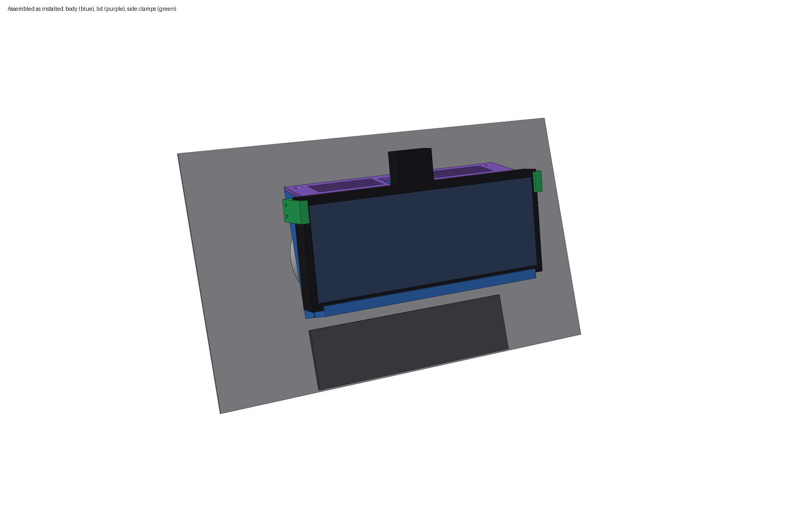
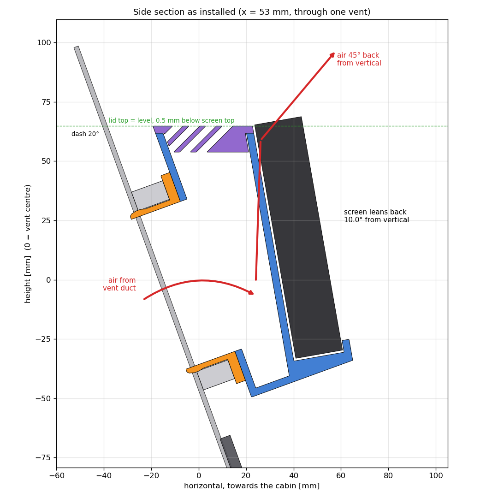
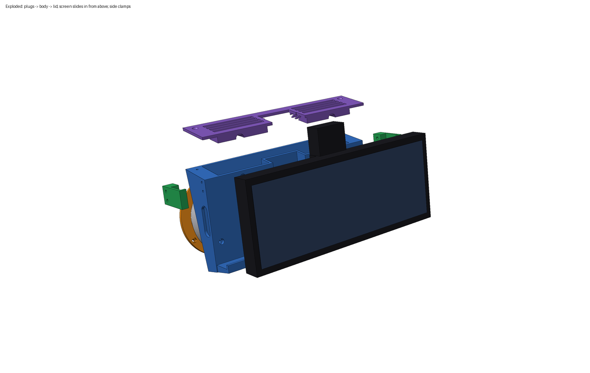

# Seat Ibiza 6J/6P facelift (2015–2017): centre-vent screen holder

Holder for the **Antika 10.26" wireless CarPlay / Android Auto screen** (Amazon B0DTDL3L7K, 245 × 100 mm, 470 g).
It sits in front of the two round centre vents, above the factory Media System touchscreen.



## How it works (v2)

- The screen is tilted **10° towards the cabin** compared with the vent face (`screen_tilt`). At the estimated 20° dash angle, it leans back only about 10° from vertical.
- The **lid is level with the ground** and sits 0.5 mm below the screen's top edge. **No part of the holder is higher than the screen.**
- Air leaves through vanes in the lid at **45° back towards the cabin** (`outlet_angle`), passing over the screen.
- Cables come through a plug into the air box and out of a **slot in each side wall**. Each slot sits right behind the screen's side edge, at the height of its ports.



| Part | Qty | What it does |
|---|---|---|
| `vent_plug_x2.stl` (orange) | 2 | Goes into the vent housing after you remove the nozzle. 6 spring fingers with snap bumps grip the housing. The flange carries 3 captive M3 nuts. |
| `body.stl` (blue) | 1 | Wedge-shaped air box bolted to both plugs. It's deeper at the top, where the air leaves. The front is the cradle: a bottom ledge with a lip, and a centre channel for the screen's rear spine and mount socket. The top is open and closed by the lid. |
| `lid.stl` (purple) | 1 | Level top with angled vanes. There's a cut-out for the spine and dash cam, and it's held by 2 countersunk screws. |
| `side_clamp_L/R.stl` (green) | 2 | Grip the screen's side edges at the top corners, with a lip over the front bezel. They stay above the port zone and never reach above the screen. Tightening the screws pulls them up to 1 mm inward, clamping the screen. |
| `fit_gauge.stl` (red) | 1 | Quick test print that checks plug diameter and vent spacing before you print the body. |



## 1. Measure (the defaults are estimates from photos)

Write your values into `params.json`, then regenerate (section 4).

| Key | Default | How to measure |
|---|---|---|
| `vent_spacing` | 130 | Horizontal distance between the centres of the two centre vents. **Most important number.** |
| `vent_id` | 76 | With the nozzle removed: inner diameter of the round housing where the plug goes in. |
| `plug_depth` | 18 | How deep the housing stays a straight round tube. Keep the plug 2–3 mm shorter. |
| `housing_od` | 92 | Outer diameter of the round vent bezel. Sets the body width: `vent_spacing + housing_od + 4`. |
| `dash_angle` | 20 | **Needed for a level lid.** Hold your phone flat against the bezel face and read the angle from vertical in a level app (iPhone: Measure → Level). |
| `scr_bottom` | −46 | From the vent centre line **down** to where the screen's bottom edge may go without covering the factory unit. Negative number. |
| `scr_w`, `scr_h`, `scr_t` | 245/100/20 | Your screen's width, height and edge thickness. |
| `spine_w`, `spine_d` | 46/16 | Width (+6 mm play) and depth of the raised spine with the mount socket on the screen's back. |
| `port_s0`, `port_s1` | 24/80 | Where the side ports start and end, measured down from the screen's top edge. The clamps stay above `port_s0`; the cable slots are centred on the port zone. |

Preferences you can change:
- `screen_tilt` (10°)
- `outlet_angle` (45°)
- `cable_side` (`both` / `left` / `right`)
- `air_gap` (16 mm at the bottom of the box)

## 2. Print

- **Material: ASA (best) or PETG. Not PLA.** A parked car's dash goes past 70 °C, and the heater blows 50–60 °C air straight through this part.
- The STLs are already oriented, and none of them need supports:
  - Body: stands on its flat bottom, 226 × 47 mm on the bed, 119 mm tall. On a 220 mm bed, place it diagonally.
  - Lid: upside down, with the level top face on the bed. The 45° vanes print fine.
  - Plug: flange down.
  - Clamps: stand on their end face.
- 4 perimeters everywhere. Body and lid: 20–25 % infill. Plugs and clamps: 40 %.
- **Print the fit gauge first.** Its rings are exactly the plug body diameter (without the bumps). They should slide into the empty housings with almost no play, and line up with both vents at once.

## 3. Hardware and assembly

The script prints the exact list. For the current parameters:

- 6 × M3×25 socket head (DIN 912) + 6 × M3 nut: plugs → body
- 4 × M3×25 socket head: side clamps → body. They cut their own thread in 2.6 mm pilot holes.
- 2 × M3×12 countersunk: lid → body
- Self-adhesive felt tape, 1 mm: on the cradle face, the ledge, and the inside of the clamp arms

Steps:

1. Pull the two centre vent nozzles out.
2. Press the M3 nuts into the hex pockets of both plugs.
3. Bolt the plugs to the back of the body. Insert the M3×25 screws from the cradle face; the heads sink into the counterbores.
4. Feed the cables from the vent duct through a plug and out of the side slot(s). Push the holder in until both flanges sit on the vent housings. If the fit is loose, wrap the fingers with electrical tape.
5. Screw on the lid.
6. Screw on both side clamps loosely.
7. Slide the screen in **from above**, between the clamps, until it sits on the ledge behind the lip.
8. Tighten the clamp screws until the screen is held firmly. Don't overtighten; the travel is limited to 1 mm.
9. Plug the cables into the side ports. Right-angle USB-C and jack plugs keep this neat.

## 4. Regenerate / view

```bash
# after editing params.json
/Applications/FreeCAD.app/Contents/Resources/bin/freecadcmd ibiza_screen_holder.py
# open the coloured model in FreeCAD (or run it via Macro > Macros… > Execute)
/Applications/FreeCAD.app/Contents/MacOS/FreeCAD show_in_freecad.py
```

The script also checks the design every time it runs:
- the parts don't overlap
- body, lid and clamps all stay below the screen's top edge

`ibiza_screen_holder.FCStd` and `assembly.step` are in the installed position, with Z up (level ground) and the cabin towards −Y. In FreeCAD:
- **Front view** is what you see from the seats.
- **Right view** shows the real angles.
- Hide the group `Stand_ins` to see only the printed parts.

## Things to know

- With the nozzles removed you can no longer aim or close the centre vents.
- The outlet (4 slots per side) is smaller than the two original nozzles, so expect somewhat less airflow, coming out faster. To get more, raise `vane_slot` or `air_gap`.
- The lid is only level if `dash_angle` matches your car.
- The screen's speaker is on its back, against the cradle, so it will sound muffled. Use Bluetooth, AUX or FM into the car's audio instead.
- The dash cam sits above the lid and can still rotate.
